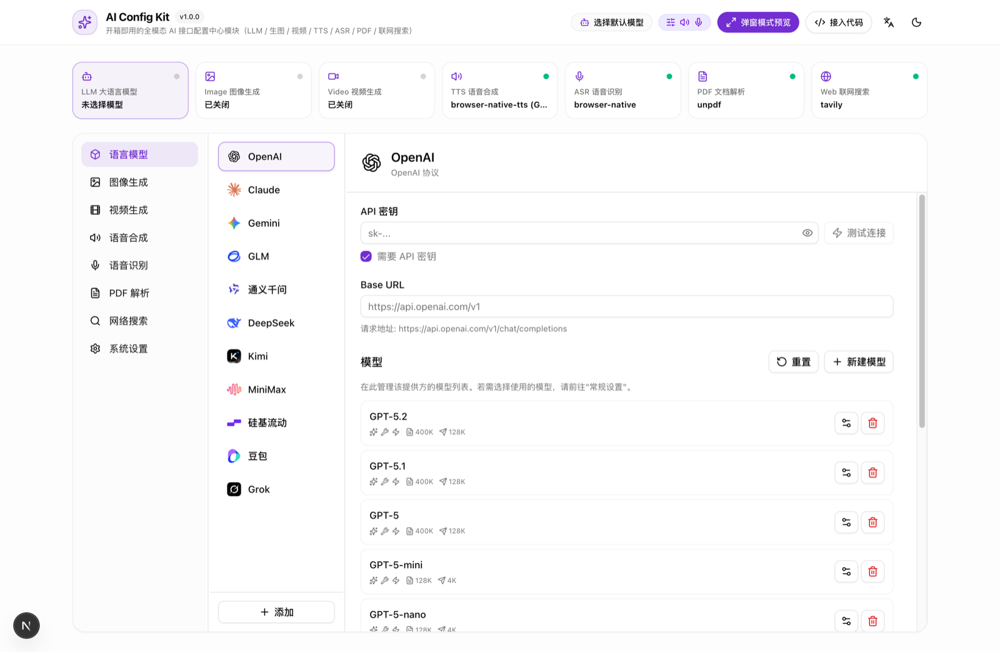

<div align="center">

# 🧩 AI Config Kit (`ai-config-kit`)

**Stop rebuilding the AI Provider Settings screen in every AI app.**  
**别再为每个 AI 产品重复手搓一遍「模型与多模态接口设置页」了。**

A production-ready, **shadcn-style copy-and-paste** Multi-Modal AI Provider Configuration Center & **BYOK (Bring Your Own Key)** UI module for **Next.js & React**.  
Extracted from [OpenMAIC](https://github.com/THU-MAIC/OpenMAIC) · Supports **LLM, Image, Video, TTS, ASR, PDF & Web Search** out of the box.

[](https://opensource.org/licenses/MIT)
[](https://nextjs.org/)
[](https://react.dev/)
[](https://sdk.vercel.ai/)
[](https://tailwindcss.com/)
[](https://www.typescriptlang.org/)
[](./llms.txt)

[Why AI Config Kit?](#-why-ai-config-kit-为什么你需要它) · [7 Modalities & 28+ Providers](#-supported-modalities--providers-支持的全模态厂商矩阵) · [Quick Start](#-quick-start-快速开始) · [3-Step Copy & Paste](#-3-step-drop-in-integration-3-步复制到你的项目) · [AI Agent Auto-Install](#-one-prompt-install-with-cursor--claude-code) · [FAQ](#-faq--comparison-常见问题与方案对比)

</div>

---

## 📸 Preview (界面预览)



> **What you see above is a single drop-in component (`<SettingsPanel />` / `<SettingsDialog />`)** paired with top-bar quick switchers (`<ModelSelector />` + `<MediaPopover />`).

---

## 💡 Why AI Config Kit? (为什么你需要它？)

Every time you build an AI application (Agent workspace, AI SaaS, Chat client, AI courseware, or internal AI tool), you inevitably need a **"Settings -> Model & API Configuration"** module.

Building a production-grade AI configuration UI from scratch takes **3–5 days** of repetitive engineering. **AI Config Kit** turns that into a **3-minute copy-paste**:

| Engineering Requirement (开发痛点) | Building From Scratch (自己手搓) | With `ai-config-kit` (直接拿走) |
| :--- | :--- | :--- |
| **Multi-Vendor LLM Registry** | Manually maintain model IDs, context windows & icons | **11 built-in LLM providers** + 60+ latest models pre-configured with SVG logos |
| **Custom Relay / Proxy (`baseUrl`)** | Custom form logic for OpenAI / Anthropic / Gemini protocols | **Built-in Custom Provider Builder** (`+ Add`) with live `/chat/completions` URL preview |
| **Multimodal Config (Image/Video/Audio)** | Separate settings pages for TTS, Whisper, Seedream, Kling, Veo | **Unified 7-Modality 3-Column Panel** (`LLM`, `Image`, `Video`, `TTS`, `ASR`, `PDF`, `Search`) |
| **Live Connectivity Verification** | Users save broken keys and fail during generation | **One-click `⚡ Test Connectivity`** for every modality + live TTS voice preview & ASR mic test |
| **Hybrid Key Resolution (BYOK + Server)** | Complex logic mixing `.env` keys and user `localStorage` keys | **Dual-Layer Config**: Server `server-providers.yml` / `.env` fallback + Client BYOK override |
| **Security & SSRF Protection** | Vulnerable to internal network probing via custom `baseUrl` | **Built-in SSRF Guard** (`ssrf-guard.ts`) blocking private IP ranges on custom base URLs |
| **Config Backup & Migration** | Users lose all keys when switching browsers | **1-Click JSON Import / Export** (with optional API key masking for safe sharing) |

---

## 🌐 Supported Modalities & Providers (支持的全模态厂商矩阵)

Unlike single-purpose LLM model pickers, `ai-config-kit` manages **all 7 core AI capability layers** required by modern agentic applications:

| Modality (能力域) | Built-in Providers (预置服务商) | Key Features (核心特性) | Verification Route (测试路由) |
| :--- | :--- | :--- | :--- |
| **1. LLM (大语言模型)** | **OpenAI**, **Anthropic (Claude)**, **Google (Gemini)**, **DeepSeek**, **Kimi (Moonshot)**, **Qwen (通义千问)**, **GLM (智谱)**, **MiniMax**, **SiliconFlow (硅基流动)**, **Doubao (豆包)**, **Grok (xAI)** + **Custom Providers** | Custom models, capability badges (`Vision`, `Thinking`, `Tools`), context window config, Vercel AI SDK adapter | `POST /api/verify-model` |
| **2. Image (图像生成)** | **Seedream (豆包即梦)**, **Qwen-Image (千问百炼)**, **Nano Banana (Gemini Image)**, **Grok Image** | Enable/disable models, add custom model IDs, aspect ratio metadata | `POST /api/verify-image-provider` |
| **3. Video (视频生成)** | **Seedance (豆包视频)**, **Kling (可灵)**, **Google Veo**, **OpenAI Sora**, **Grok Video** | Text-to-video & Image-to-video model registry, custom model IDs | `POST /api/verify-video-provider` |
| **4. TTS (语音合成)** | **Browser Native Web Speech**, **OpenAI TTS**, **Azure TTS**, **GLM-TTS**, **Qwen-TTS**, **Volcengine (火山豆包语音)**, **ElevenLabs** | Voice list per provider, speed slider (`0.5x–2.0x`), **live audio preview** | `POST /api/generate/tts` |
| **5. ASR (语音识别)** | **Browser Native SpeechRecognition**, **OpenAI Whisper**, **Qwen-ASR** | Language selection, **live microphone recording & transcription test** | `POST /api/transcription` |
| **6. PDF (文档解析)** | **UNPDF (Local/Zero-Key)**, **MinerU (高精度学术/公式解析)** | Zero-config local fallback + MinerU API key & base URL test | `POST /api/verify-pdf-provider` |
| **7. Web Search (联网搜索)** | **Tavily AI Search** | API key & custom endpoint configuration + live search probe | `POST /api/verify-web-search` |

---

## 🤖 One-Prompt Install with Cursor / Claude Code

Using an AI coding agent (**Cursor**, **Claude Code**, **Antigravity**, **Windsurf**, **Cline**)?  
Copy and paste this single prompt into your agent to automatically integrate `ai-config-kit` into your existing Next.js project:

```text
Please integrate https://github.com/nans94759-sketch/ai-config-kit into my Next.js project.
Read the repository's AGENTS.md and llms.txt first, then copy `components/settings/`, `lib/`, `app/api/`, and `public/logos/` into my project and wire up `<SettingsDialog />` and `<ModelSelector />`.
```

---

## 🚀 Quick Start (快速开始)

### Option A: Run as a Standalone Playground (独立克隆运行)

```bash
git clone https://github.com/nans94759-sketch/ai-config-kit.git
cd ai-config-kit
npm install
npm run dev
```

Open `http://localhost:3000` to explore:
- **Top Navbar**: `<ModelSelector />` popover + `<MediaPopover />` quick toggles + Modal trigger + `zh-CN / en-US` switch + Dark/Light mode.
- **Live Status Bar**: Real-time status across all 7 AI capability categories.
- **3-Column `<SettingsPanel />`**: Embedded directly on the page for instant testing.

---

## 🧩 3-Step Drop-in Integration (3 步复制到你的项目)

Designed with the **shadcn/ui philosophy**: you own the code. Copy the modular directories directly into any Next.js (App Router + Tailwind CSS v4) project:

### Step 1: Copy the Modular Directories

```text
your-nextjs-app/
├── public/logos/                # 21 SVG/PNG provider icons (OpenAI, Claude, DeepSeek, Kimi, Qwen, etc.)
├── components/settings/         # Complete Settings UI (<SettingsDialog />, <SettingsPanel />, <ModelSelector />, <MediaPopover />)
├── components/ui/               # 19 shadcn/Radix UI primitives (merge with your existing components/ui)
├── lib/
│   ├── store/settings.ts        # Zustand persisted store ('ai-config-kit-storage') + JSON import/export
│   ├── ai/                      # LLM provider registry + Vercel AI SDK getModel() factory
│   ├── media/                   # Image & Video provider registries + connectivity adapters
│   ├── audio/                   # TTS & ASR provider registries + live preview hooks
│   ├── pdf/                     # PDF parser definitions (UNPDF & MinerU)
│   ├── web-search/              # Tavily search client
│   ├── server/                  # Dual-layer key resolver (provider-config.ts), resolveModel() & SSRF guard
│   ├── hooks/                   # Zero-config safe useI18n() & useTheme() hooks (work even without Providers!)
│   ├── i18n/                    # Built-in zh-CN & en-US translations
│   └── types/                   # TypeScript interfaces
└── app/api/                     # 8 backend verification & server-provider sync routes
    ├── server-providers/route.ts
    ├── verify-model/route.ts
    ├── verify-image-provider/route.ts
    ├── verify-video-provider/route.ts
    ├── verify-pdf-provider/route.ts
    ├── verify-web-search/route.ts
    ├── generate/tts/route.ts
    └── transcription/route.ts
```

### Step 2: Mount the UI Components Anywhere

> 💡 **Zero-Provider Safe**: `useI18n()` and `useTheme()` include built-in default fallbacks, so `<SettingsDialog />`, `<SettingsPanel />`, `<ModelSelector />`, and `<MediaPopover />` work immediately even if you don't wrap your root `layout.tsx`!

```tsx
'use client';

import { useState } from 'react';
import {
  SettingsDialog,
  SettingsPanel,
  ModelSelector,
  MediaPopover,
} from '@/components/settings';

export default function ChatHeader() {
  const [open, setOpen] = useState(false);

  return (
    <header className="flex items-center gap-3 p-4 border-b">
      {/* 1. Multimodal capability quick-switcher (Image / Video / TTS / ASR) */}
      <MediaPopover onSettingsOpen={() => setOpen(true)} />

      {/* 2. Open full 3-column configuration modal */}
      <button onClick={() => setOpen(true)}>⚙️ AI Provider Settings</button>
      <SettingsDialog open={open} onOpenChange={setOpen} />
    </header>
  );
}
```

### Step 3: Resolve the Active Model in Your Backend API

#### On the Client (Frontend):
```ts
import { useSettingsStore } from '@/lib/store/settings';

const { providerId, modelId, providersConfig } = useSettingsStore.getState();
const activeProvider = providersConfig[providerId];

await fetch('/api/chat', {
  method: 'POST',
  headers: {
    'x-model': `${providerId}:${modelId}`,
    'x-api-key': activeProvider?.apiKey || '',
    'x-base-url': activeProvider?.baseUrl || '',
    'x-provider-type': activeProvider?.type || 'openai',
  },
  body: JSON.stringify({ messages }),
});
```

#### On the Server (Next.js Route Handler):
```ts
import { NextRequest } from 'next/server';
import { streamText } from 'ai';
import { resolveModelFromHeaders } from '@/lib/server/resolve-model';

export async function POST(req: NextRequest) {
  const { messages } = await req.json();

  // Automatically resolves: Client BYOK Key > server-providers.yml > .env
  const { model } = await resolveModelFromHeaders(req);

  const result = streamText({ model, messages });
  return result.toTextStreamResponse();
}
```

---

## 🔒 Dual-Layer Configuration Architecture (客户端 BYOK + 服务端预置双层架构)

`ai-config-kit` supports two complementary configuration layers out of the box:

1. **Client-Side BYOK (`localStorage`)**:
   - Users enter their own API keys and custom relay `baseUrl` in the browser.
   - Keys are stored locally in `localStorage` (`ai-config-kit-storage`) and can be exported/imported as JSON.
2. **Server-Side Pre-configured Keys (`server-providers.yml` or `.env`)**:
   - Team admins or SaaS hosts can configure shared API keys in `server-providers.yml` or `.env.local`.
   - **`GET /api/server-providers` never exposes raw API keys to the browser**—it only sends `isServerConfigured: true` metadata so the UI automatically displays a `"Server Configured / 服务端已配置"` badge.
   - When a request hits the backend, `resolveModel()` prioritizes the user's custom key/baseUrl if provided, and seamlessly falls back to the server key.

---

## ❓ FAQ & Comparison (常见问题与方案对比)

### 1. When should I use `ai-config-kit`? (适用场景)
Use `ai-config-kit` whenever you are building a **Next.js / React AI application** that needs:
- A **Cherry Studio / LobeChat / OpenMAIC style** multi-provider settings dialog.
- **BYOK (Bring Your Own Key)** support where users can plug in their own OpenAI, Claude, Gemini, DeepSeek, Qwen, Kimi, or custom OpenAI-compatible proxy keys.
- Unified configuration for **multi-modal AI pipelines** (combining LLM + Image Generation + Video Generation + TTS + ASR + PDF Parsing + Web Search in one store).

### 2. How does `ai-config-kit` compare to other projects?
| Project | Positioning | Can I copy-paste just the Settings UI into my Next.js app? |
| :--- | :--- | :--- |
| **Cherry Studio / LobeChat** | Full monolithic desktop/web chat applications (100k+ LOC) | ❌ Tightly coupled to their internal database, auth, and chat state |
| **Vercel AI SDK (`ai`)** | Backend/frontend SDK for calling models | ❌ Headless SDK only; does not provide a provider management UI or BYOK store |
| **AI Config Kit (`ai-config-kit`)** | **Standalone, decoupled AI Provider Configuration UI + Store + Verification APIs** | ✅ **Yes — 100% self-contained module designed specifically to be copied into any app** |

### 3. Can I use only the LLM settings without Image/Video/TTS?
Yes. In `components/settings/index.tsx`, the left navigation sidebar items correspond to each capability section (`providers`, `image`, `video`, `tts`, `asr`, `pdf`, `web-search`, `general`). You can comment out any section you don't need in 5 seconds.

---

## 🤝 Contributing & License

Contributions, issues, and PRs for new AI providers are welcome!  
Licensed under the **MIT License**. Attribution appreciated when used in open-source or commercial products.
